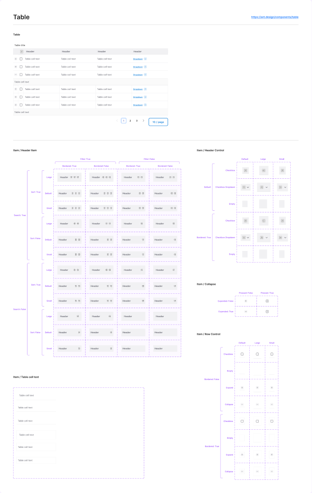

# Table

## Figma
Page **Table** (`2665:4743`), file `ilpJ5K66cGR85o287K4HDD`. Everything is inside frame `ThemeDefault` (`2707:5698`), which also contains an example table (`2707:5711`) and instance sheets.

| Component set | Node id | Variants |
|---|---|---|
| Item / Header Item | `2707:5930` | 6 |
| Item / Header Control | `2707:6036` | 18 |
| Item / Row Control | `2707:6136` | 24 |
| Item / Collapse | `2707:6204` | 4 |
| Item / Table cell text | `2707:6225` | 6 |



## Description
No Figma descriptions. Purpose: building blocks for data tables (header cells with sort/filter/search, checkbox/expand control columns, and body text cells), composed into rows. The example table is 944 wide, with a title, a header row, rows, and the Pagination component below.

## Variant axes and props
| Set | Axes | Non-variant props (default) |
|---|---|---|
| Header Item | `Size: Large\|Default\|Small; Bordered: False\|True` | `Text` ("Header"), `Sort`, `Filter`, `Search` (all true) |
| Header Control | `Type: Checkbox\|Checkbox Dropdawn\|Empty; Size; Bordered: Default\|True` | – |
| Row Control | `Type: Checkbox\|Empty\|Expand\|Collapse; Size; Bordered: False\|True` | – |
| Collapse | `Expended: False\|True; Pressed: False\|True` | – |
| Table cell text | `Size; Bordered: False\|True` | `String` ("Table cell text"), `Text` (true), `Dropdown`, `Tag`, `Button 1`, `Button 2` (false) |

## Anatomy
Header Item (Default):
```
Header Item (COMPONENT, 147x46)
└─ Header  FRAME H, padding 12/0 (Space/Padding/paddingSM), bg, bottom border
   └─ Wrapper  H, padding 0/8, gap 8, 0.5px right divider
      ├─ Header TEXT 14 SemiBold
      └─ icon-12 x3 (sort, filter, search)
```
Table cell text (Default): H auto-layout, 240x48, padding 12/8 (`Space/Padding/paddingSM` / `paddingXS`), gap 8, bottom border 1px. It contains a Text Wrapper holding 14 Regular text, plus optional dropdown, tag and buttons.

Row heights by Size:

| Size | Header Item | Cell text | Row Control (checkbox/empty) |
|---|---|---|---|
| Small | 38 | 40 | 46 |
| Default | 46 | 48 | 38 |
| Large | 54 | 56 | 54 |

Header Control is 40 (Default) / 48 (Small) / 56 (Large). Note that Small is taller than Default for the controls.

## Token table
| part | value |
|---|---|
| header background | #f1f1f3 (no token, nearest `bg/variant`) |
| header text | #60616c 14 SemiBold (no token, nearest `text/subtle`) |
| cell text | #60616c 14 "9pt Regular" |
| row / header divider | 1px bottom #e4e4e7 (no token, nearest `border/default`). Bordered=True adds 0.5px borders on all sides (cells) or top+bottom (header) |
| header column divider | 0.5px right #e4e4e7 |
| cell background | none (white) |
| checkbox | Checkbox instance 20x20, radius 2, 1.5px #c4c4c4 border (legacy checkbox) |
| expand/collapse toggle | 16x16 plate, radius 4, bg #f8f8f9, 1px #e4e4e7 border (pressed: #484951 border), +/– glyph #484951 |
| padding | cell 12/8; header 12/0 with an 8px inner wrapper; controls 8 |

## Notes
- **This is a legacy component** (same generation as Pagination). It uses an off-palette grey scale (#f1f1f3, #60616c, #e4e4e7, #f8f8f9, #484951, #c4c4c4), old spacing variables (`Space/Padding/paddingSM/XS/XXS`) and an older checkbox. None of its colours map exactly to the current `--aec-color-*` tokens. Suggested mapping: header bg `bg/variant`, text `text/subtle`/`text/default`, dividers `border/default`, checkbox from the current Checkbox component.
- Typos in Figma: "Checkbox Dropdawn", "Expended".
- The Size ordering is inconsistent: for Row/Header controls, "Small" is taller than "Default".
- There are no hover, selected or zebra row states.
