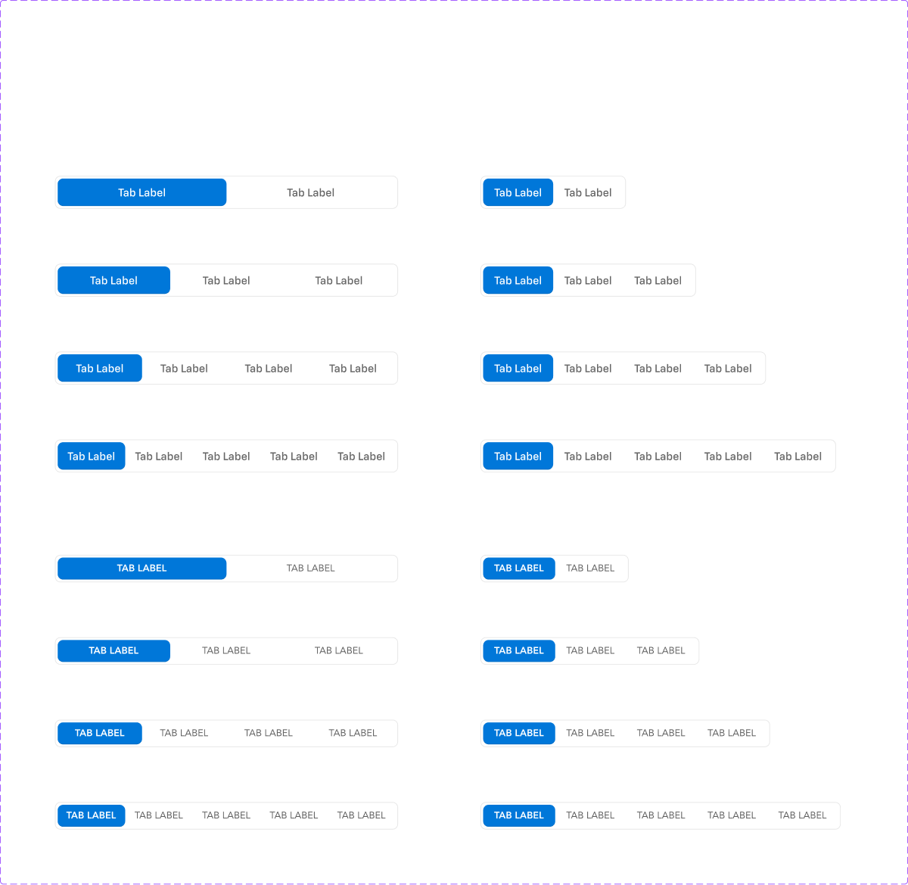
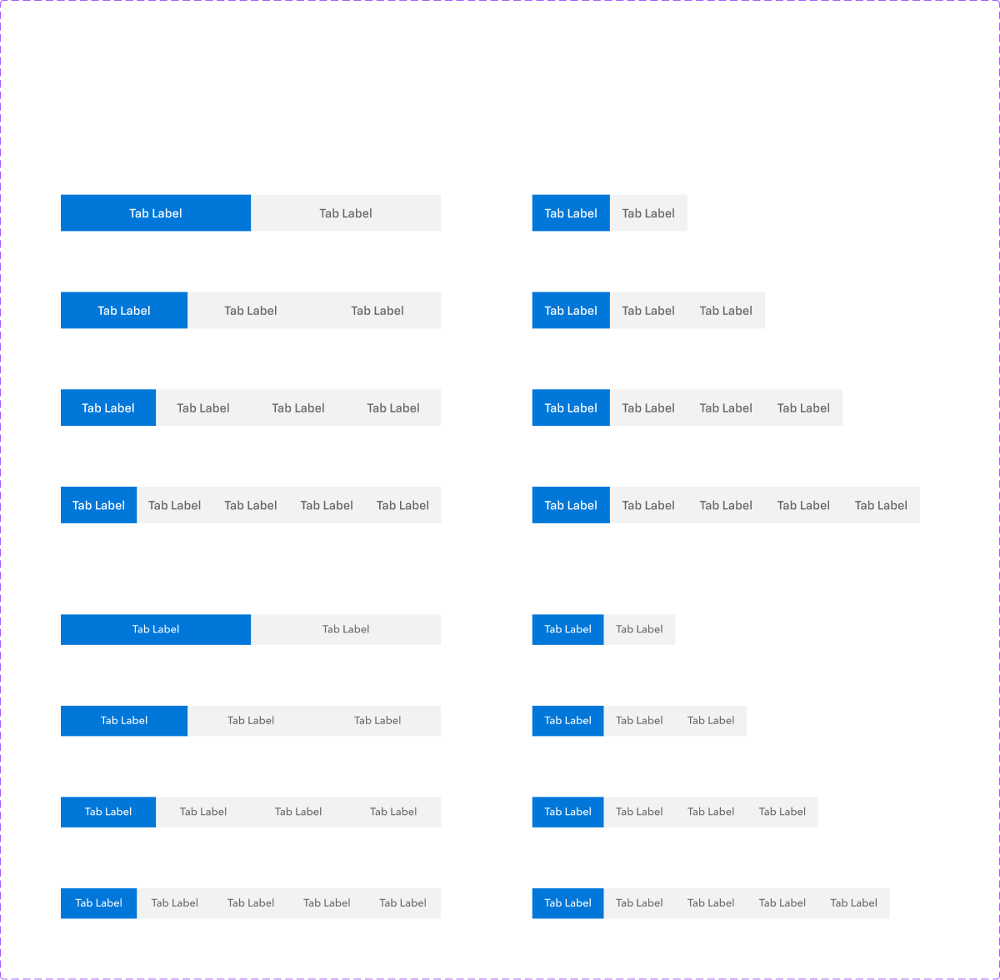
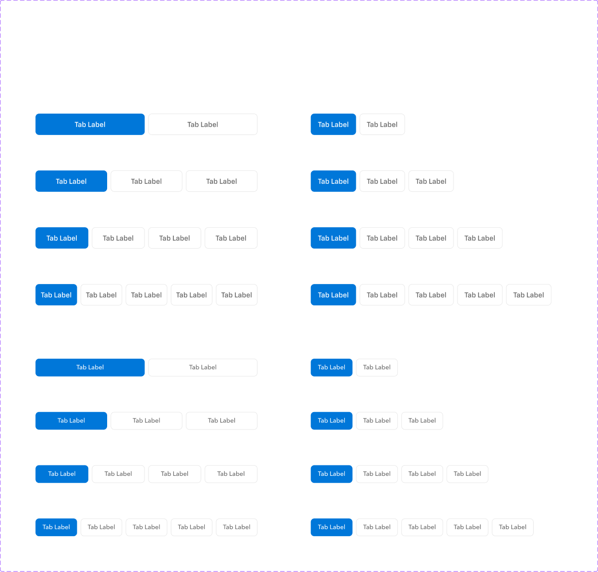
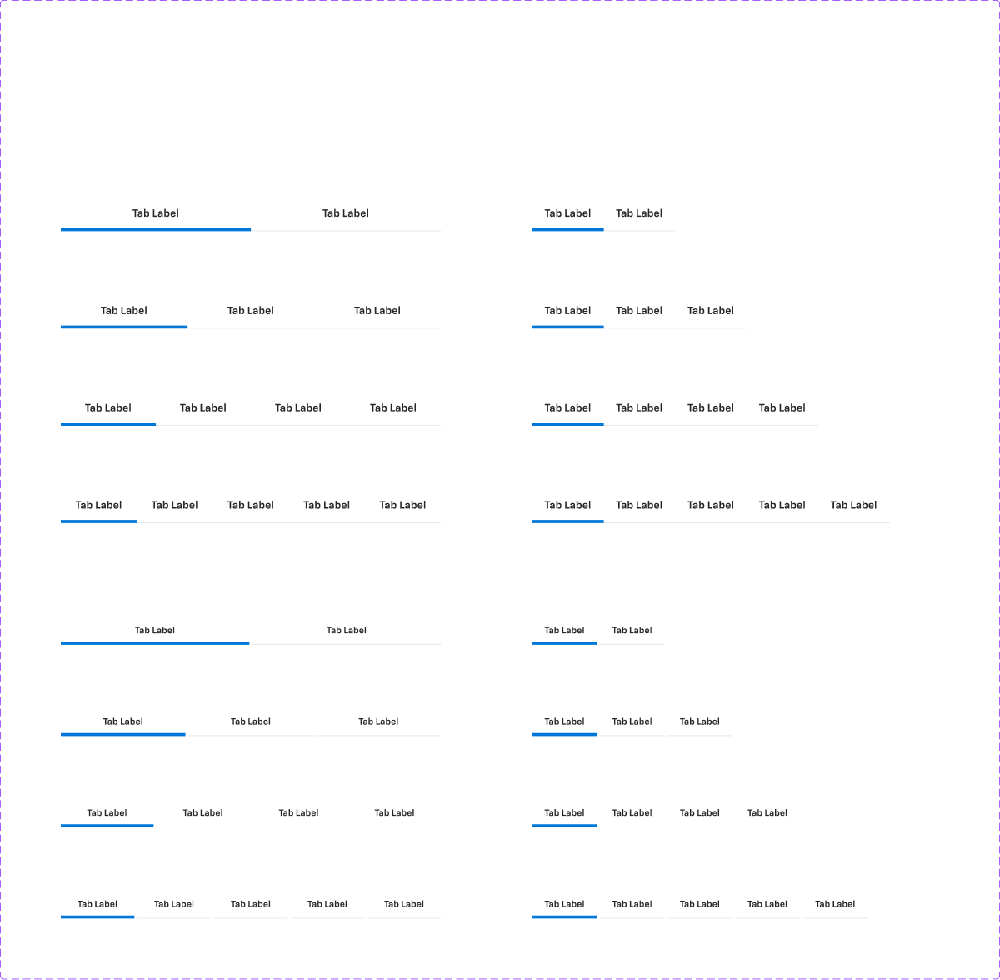
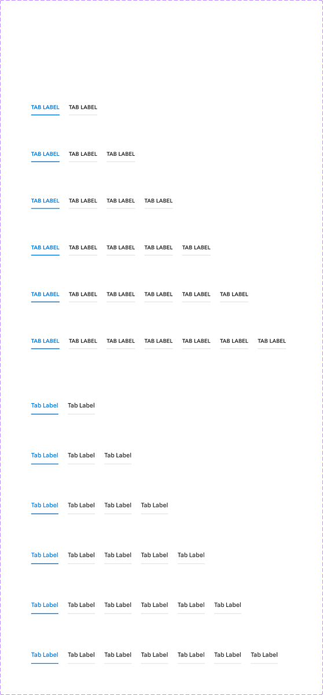
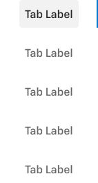

# Tabs

## Figma
Page **Tabs** (`3769:50222`), file `ilpJ5K66cGR85o287K4HDD`. All sets sit in `Section 1` (`5760:92635`).

| Component set | Node id | Variants |
|---|---|---|
| Contained | `4527:65812` | 16 |
| Segment | `4782:66564` | 16 |
| Stacked | `4783:67398` | 16 |
| Underlined - Inset | `4783:68232` | 16 |
| Underlined - Inside | `4783:69900` | 12 |
| vertical (component) | `4791:68774` | – |
| .tab-item-contained (hidden base) | `4527:65751` | 12 |
| .tab-item-segment | `4782:66503` | 12 |
| .tab-item-stacked | `4783:67337` | 12 |
| .tab-item-underlined-inset | `4783:68171` | 12 |
| .tab-item-underlined-inside | `4783:69839` | 12 |
| .tab-item-vertical | `4791:68652` | 12 |








## Description
No Figma descriptions. Purpose: switch between views of related content. There are six visual styles: Contained (pill inside a bordered track), Segment (joined segmented control), Stacked (separate bordered buttons), Underlined Inset (full-width underline), Underlined Inside (text tabs with an underline under each label), and Vertical (side navigation).

## Variant axes and props
- **Bar sets**:
  - Contained: `size: medium|large; count: 2|3|4|5; fixed-width: on|off`
  - Segment, Stacked and Underlined - Inset: `variable-width: off|on` instead of fixed-width
  - Underlined - Inside: `size; count: 2..7` (no width axis)
  - No non-variant props.
- **Item sets** (`.tab-item-*`): `size: medium|large; state: default|hover|active; selected: true|false; disabled: false|true`. Hover/active exist only for selected=false. Non-variant props: `left-icon` (false), `badge` (false).
- **vertical**: a single component, a 142x264 V stack (gap 16, `spacing/selectable/gap/l`) of 5 `.tab-item-vertical` (large). The first item is selected.

## Anatomy
Contained (medium, count=3, fixed-width=on):
```
Contained (COMPONENT, H auto-layout, 500x40, padding 4, radius 8, 1px border)
└─ .tab-item-contained x3  (fill width, 32 tall, padding 0/16, gap 8, radius 8, inner shadow 0 -1 0 rgba(0,0,0,.1))
   └─ label-container  H, gap 8 (spacing/selectable/gap/m)
      ├─ left icon (hidden) · Tab Label TEXT · Badge (hidden)
```
- **Segment**: 500x40, no padding, gap 0. Items are 40 tall, square corners.
- **Stacked**: gap 8. Items are 40 tall, radius 8, 1px border.
- **Underlined Inset**: gap 4. Items are 40 tall with a bottom border (1px, or 4px when selected), label-container padding 0/16.
- **Underlined Inside**: hug-width items, gap 24. The label-container carries a 2px bottom border.
- **Vertical item**: 142x40, padding 0/16. The label-container has padding 0/8 and radius 4. Selected adds a 2px right border.
- Item heights in the item sets are hug (22/24). Bar instances stretch them to 32 (contained) or 40.
- **Size medium**: labels are all caps 14px (the Contained screenshot shows a medium row in "TAB LABEL"). **Size large**: 16 Medium sentence case.

## Token tables (medium; large is identical except for 16px text)
### Contained
| state | item bg | text |
|---|---|---|
| default | transparent | `text/subtle` 14 Roman |
| hover / active | `bg/variant` | `text/default` |
| selected | `primary/default` | `primary/on-default`, 14 Heavy |
| disabled (selected or not) | transparent | `text/disabled` |

Track: 1px `border/default`, radius 8, padding 4.

### Segment
| state | bg | text |
|---|---|---|
| default | `bg/variant` | `text/subtle` 14 Medium |
| hover / active | `bg/variant` (same as default) | `text/default` |
| selected | `primary/default` | `text/inverse` |
| disabled | `bg/disabled` | `text/disabled` |
| disabled + selected | `bg/default` | `text/disabled` |

### Stacked
| state | bg | border 1px | text |
|---|---|---|---|
| default | `bg/default` | `border/default` | `text/subtle` 14 Medium |
| hover | `bg/variant` | `border/variant` | `text/default` |
| active | `bg/variant` | `action/border/active` | `text/default` |
| selected | `primary/default` | none | `text/inverse` |
| disabled | `bg/disabled` | `border/disabled` | `text/disabled` |
| disabled + selected | `bg/default` | none | `text/disabled` |

### Underlined - Inset
| state | bg | bottom border | text |
|---|---|---|---|
| default / hover | `bg/default` | 1px `border/default` | `text/default` 12 Demi (large 14 Demi) |
| active | `bg/default` | 1px `primary/default` | `text/default` |
| selected | transparent | **4px** `primary/default` | `text/default` |
| disabled | transparent | 1px `border/default` | `bg/disabled` colour (#c3cfd9) |
| disabled + selected | transparent | 4px `border/disabled` | `text/disabled` |

### Underlined - Inside
| state | label bg | bottom border 2px | text |
|---|---|---|---|
| default | transparent | `border/default` | `text/default` 14 Heavy |
| hover | `bg/variant` | `border/variant` | `text/default` |
| active | transparent | `primary/default` | `text/default` |
| selected | transparent | `primary/default` | `primary/default` |
| disabled (± selected) | transparent | `border/disabled` | `text/disabled` |

### Vertical
| state | label bg (radius 4) | text | indicator |
|---|---|---|---|
| default | transparent | `text/subtle` 14 Medium | – |
| hover / active | `bg/variant` | `text/default` | – |
| selected | `bg/variant` | `text/default` | 2px right border `primary/default` |
| disabled (± selected) | transparent | `text/disabled` | – |

## Notes
- **The font family is inconsistent in the medium items:** Contained and Underlined-Inside medium use *Avenir LT Pro* (55 Roman / 85 Heavy), Segment and Stacked medium use *Avenir Next Medium*, and the rest (and all large sizes) use *Chevy Sans*. Normalise to one family.
- The Underlined Inset label is Demi weight and one size smaller (12/14) than the other styles. Its disabled text uses `bg/disabled` (#c3cfd9) rather than `text/disabled`.
- Segment hover/active have the same background as default; only the text colour changes.
- Hover and active are identical in Contained, Vertical and Segment.
- There is no focus state on any tab item.
- Colours are raw hex. Gaps are bound to `spacing/selectable/gap/*`. No text styles are bound.
