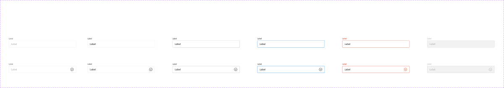
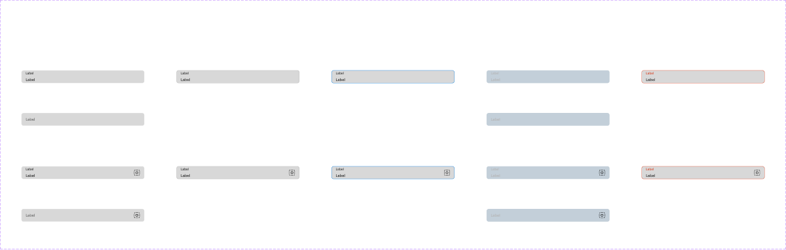

# Text Field

## Figma
Page **Text Field** (`3769:50178`), 19 top-level items (16 component sets + docs).

Public sets:
| Component set | Node id | Variants |
|---|---|---|
| Standard Text Input - Outlined | `2977:55272` | 12 |
| Material Text Input - Filled | `5030:52020` | 14 |
| standard-text-input-outlined-prefix | `4787:67049` | 8 |
| standard-text-input-outlined-suffix | `2977:51293` | 8 |

Hidden (`.`) sets: `.assistive-text` `2154:26885` (4), `.Material Text Input - Outlined` `2977:51504` (14), `.Material Text Input - Plain` `5034:52990` (14), `.Standard Text Input - Filled` `5007:51518` (10), and eight material/standard prefix/suffix helpers (`2973:50316`, `5030:51906`, `5034:52876`, `2973:50338`, `5030:51951`, `5034:52921`, `5007:51408`, `5007:51473`; 8 each).




## Description
No Figma descriptions. Purpose: single-line text entry (`type=text-input`) or a select-style trigger (`type=dropdown`). **Standard** puts the label above the box. **Material** puts a floating label inside the box.

## Variant axes
- **Standard Text Input - Outlined**: `type: text-input|dropdown; state: default|hover|active|error|prompt; disabled: false|true` (disabled only with state=default). Props (bool): `label` (true), `Mandatory`, `label-icon`, `prefix`, `suffix`, `left-icon`, `right-icon`, `assistive-text`, `focus-ring` (all false).
- **Material Text Input - Filled**: `type: text-input|dropdown; state: default|hover|active|prompt|error; disabled` (14 variants, including prompt+disabled). Props: `assistive-text`, `prefix`, `suffix`, `left-icon`, `right-icon`, `focus-ring`.
- **prefix / suffix**: `prefix|suffix: dropdown|text|icon; state: default|hover|active; disabled`. Props: `left-icon`, `right-icon`.
- **.assistive-text**: `type: default|error|success|warning`. Prop: `left-icon`.

## Anatomy — Standard Text Input - Outlined (460x72, V auto-layout, gap 4)
```
├─ Label                     FRAME H, gap 2, 20 tall
│   ├─ Edit Label            TEXT "Label" 12px Chevy Sans Medium
│   ├─ Edit Label (hidden)   TEXT "*" 12px, style error/default  (Mandatory)
│   └─ icon-12 (hidden)      label-icon
└─ assistive-text-container  FRAME V, gap 4
    ├─ text-input-container  FRAME H 460x48, radius 4, fill bg/default, stroke 1 inside
    │   ├─ prefix (hidden)   INSTANCE standard-text-input-outlined-prefix (padding-left 16, gap 16, divider 1px)
    │   ├─ text-container    FRAME H, padding 0/16, gap 8
    │   │   ├─ left icon (hidden, icon-24)
    │   │   ├─ Edit Text     TEXT 16px Chevy Sans Medium, line 24
    │   │   └─ right icon (hidden, icon-24)   (dropdown type: chevron icon)
    │   ├─ suffix (hidden)   INSTANCE …-suffix
    │   └─ focus-ring (hidden) 468x56, radius 12, 2px focus/default
    └─ assistive-text-wrapper (hidden) → .assistive-text (12px, gap 4, optional 16px icon)
```
Variables: height `sizing/selectable/l` (48), `border/width/10` (1), gaps `spacing/selectable/gap/s` (4) and `gap/m` (8).

## Anatomy — Material Text Input - Filled (460x48)
`prefix-suffix-container` (H, radius 8, stroke 1) → `text-field-container` (padding 0/16) → `label-container` (V, gap 4: label 12px + value 14px) + right icon. The prefix/suffix have a 2px bottom stroke. It has the same focus ring, plus assistive-text below.

## Token table — Standard Outlined
| State | Box bg | Box border (1px) | Label | Value text |
|---|---|---|---|---|
| default | bg/default | border/default (#e6e6e6) | text/default, 12px Medium | text/default, 16px Medium |
| prompt (placeholder) | bg/default | border/default | text/subtle (#666) | text/disabled (#b3b3b3) |
| hover | bg/default | border/variant (#b3b3b3), same as action/border/hover | text/default | text/default |
| active (focused) | bg/default | primary/default = action/border/active (#0077d9) | text/default | text/default |
| error | bg/default | error/default | error/default | text/default |
| disabled | bg/variant (#f2f2f2) | border/disabled | text/disabled | text/disabled |
| focus-ring (bool) | 2px focus/default, radius 12, 4px outset | | | |
Dropdown type: same as above, plus the chevron in icon/default (error: error/default, disabled: icon/disabled).

## Token table — Material Filled
| State | Box bg | Border (1px) | Label | Value |
|---|---|---|---|---|
| default | light-grey/weak (#d8d8d8) | border/default | text/default 12px | text/default 14px |
| prompt | #d8d8d8 | border/default | text/subtle 14px (label acts as placeholder, no value) | — |
| hover | #d8d8d8 | border/variant | text/default | text/default |
| active | #d8d8d8 | primary/default | text/default | text/default |
| error | #d8d8d8 | error/default | error/default | text/default |
| disabled | bg/disabled (#c3cfd9) | border/disabled | text/disabled | text/disabled |

## Prefix / Suffix (standard outlined)
24 tall, padding-left 16 (prefix) or padding-right 16 (suffix), gap 16, 1px divider in border/default (disabled: border/disabled). Text "Prefix"/"Suffix" is 16px Chevy Sans Medium with the **`text/default` colour style bound**, the only bound style found on these pages. Disabled text is #cccdd1, which has no token. Variants: dropdown (text + 16px arrow), text, icon (24px).

## Assistive text colours
default text/subtle · error error/default · success success/default · warning warning/default (12px Chevy Sans Medium).

## Notes
- Hover and active only change the border colour; there's no shadow.
- The standard box radius is 4 (`--aec-border-radius-rounded-rect`), but Material uses 8.
- Error only colours the label and border. The error message itself comes from `assistive-text` (type=error), which is a separate hidden component.
- Standard Outlined has no prompt+disabled variant; Material does.
- Many sets are hidden (`.`). Only Standard Outlined and Material Filled are published input styles. Material Outlined, Material Plain and Standard Filled are hidden.
