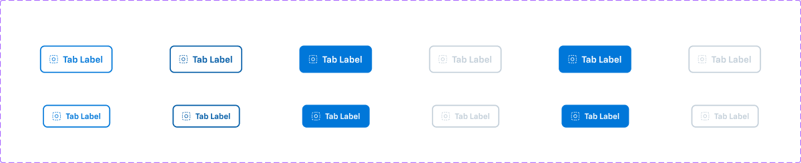
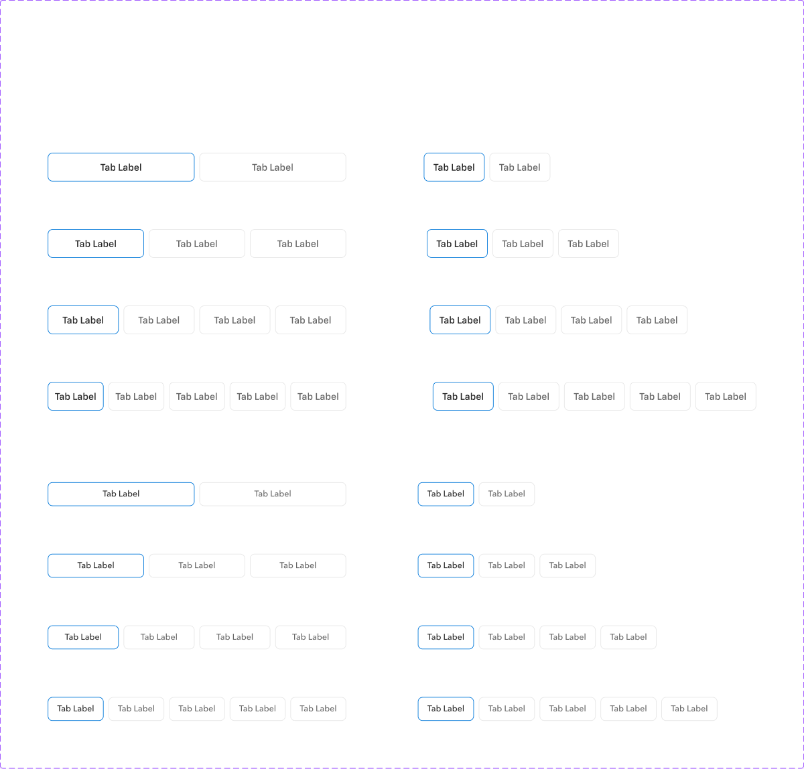

# Toggle Button

## Figma
Page **Toggle Button** (`3769:50180`).

| Component set | Node id | Variants |
|---|---|---|
| Toggle Button Option 1 | `5510:7908` | 12 |
| Toggle Button Option 2 | `3101:3101` | 12 |
| Toggle Button Option 3 | `3101:3246` | 12 |
| Toggle group tab-item Option 1 | `5173:707177` | 12 |
| Toggle group tab-item Option 2 | `5173:707238` | 12 |
| Toggle group tab-item Option 3 | `5173:707299` | 12 |
| Toggle Button Group Option 1 | `5063:49384` | 16 |
| Toggle Button Group Option 2 | `3101:1723` | 16 |
| Toggle Button Group Option 3 | `3101:2412` | 16 |

The page also has frames "Toggle Button Option 4–9" (`5997:971`, `:978`, `:992`, `:985`, `:999`, `:1006`; 48x48 each, not components) and doc labels like `drp-toggle-button--option-2`.




## Description
No Figma descriptions. Purpose: a selectable button, or a segmented group of them, for choosing one option. "Option 1/2/3" are **competing design explorations**, not distinct components.

## Variant axes
- **Toggle Button / Toggle group tab-item (all options)**: `size: medium|large; state: default|hover|active; selected: true|false; disabled: false|true`. Props: `left-icon` (bool; default true in Button Option 1, false elsewhere) and `badge` (bool, false, a `Badge` primary/small instance).
- **Toggle Button Group**: `size: medium|large; count: 2|3|4|5; variable-width: off|on`. Fixed width is 500px, split equally. Variable width hugs the items. Gap 8.

## Anatomy (Toggle Button Option 1, large/default)
```
Toggle Button (COMPONENT 127x48, H auto-layout, padding 16, gap 8, radius 8, stroke 2 inside)
└─ label-container  FRAME H, gap 8
    ├─ left icon    INSTANCE icon-16 (16x16)
    ├─ Tab Label    TEXT "Tab Label" 16px Chevy Sans Demi (medium: 14px)
    └─ Badge        INSTANCE (hidden) 16x16, radius 384, primary/default
```
Sizes: large 48 tall, medium 40 tall. Tab-item: H, padding 0/16, gap 8, radius 8, 1px stroke. The master is 24px tall but stretches to 40/48 inside the group. Bound variables: `spacing/selectable/gap/m` and `bg/default`.

## Token table — Toggle Button Option 1 (blue outline → filled)
| State | Bg | Border (2px) | Label / icon |
|---|---|---|---|
| unselected default | bg/default | primary/default | primary/default, 16px Demi |
| unselected hover | bg/default | primary/hover | primary/hover |
| unselected active (pressed) | primary/default | none | primary/on-default |
| selected | primary/default | none | primary/on-default |
| disabled (selected or not) | bg/default | border/disabled | #c3cfd9 (border/disabled) |

## Token table — Toggle group tab-item Option 1 (used by Group Option 1)
| State | Bg | Border (1px) | Label |
|---|---|---|---|
| unselected default | bg/default | border/default | text/subtle (#666), 16px Medium |
| unselected hover | bg/default | border/variant (= action/border/hover) | text/default |
| unselected active | bg/default | primary/default (action/border/active) | text/default |
| selected | bg/default | primary/default | text/default |
| selected disabled | bg/variant (#f2f2f2) | border/disabled | text/disabled |
| unselected disabled | bg/default | border/disabled | text/disabled |

## Other explorations (large)
- **Option 2 (text only, no bg/border)**: label primary/default, hover and active primary/hover, selected primary/default (looks the same as unselected default), disabled text/disabled.
- **Option 3 (subtle)**: 1px border. Unselected: bg/default, border border/default, hover primary/hover, active primary/default, label always primary/default. Selected: bg primary/subtle (#ecf1fc), border primary/default. Disabled keeps the primary label and only the border goes to border/disabled; selected+disabled looks the same as selected.

## Notes
- Three parallel options exist for the button, tab-item and group. Decide which one ships. Option 1 has the newest node id (5510) and is the only one with left-icon on by default.
- In Option 2, selected and unselected-default are visually identical, so there's no selected indicator.
- In Option 3, disabled doesn't grey out the label.
- Tab-item masters are 24px tall (hug), while the group instances are 40/48.
- Hover and active differ here, unlike Button.
