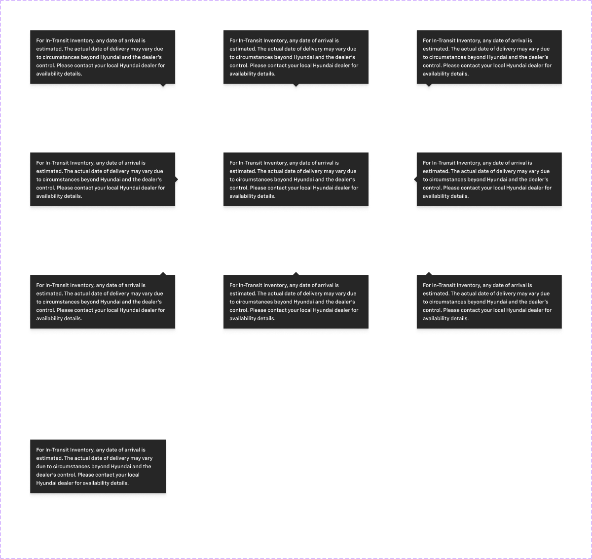
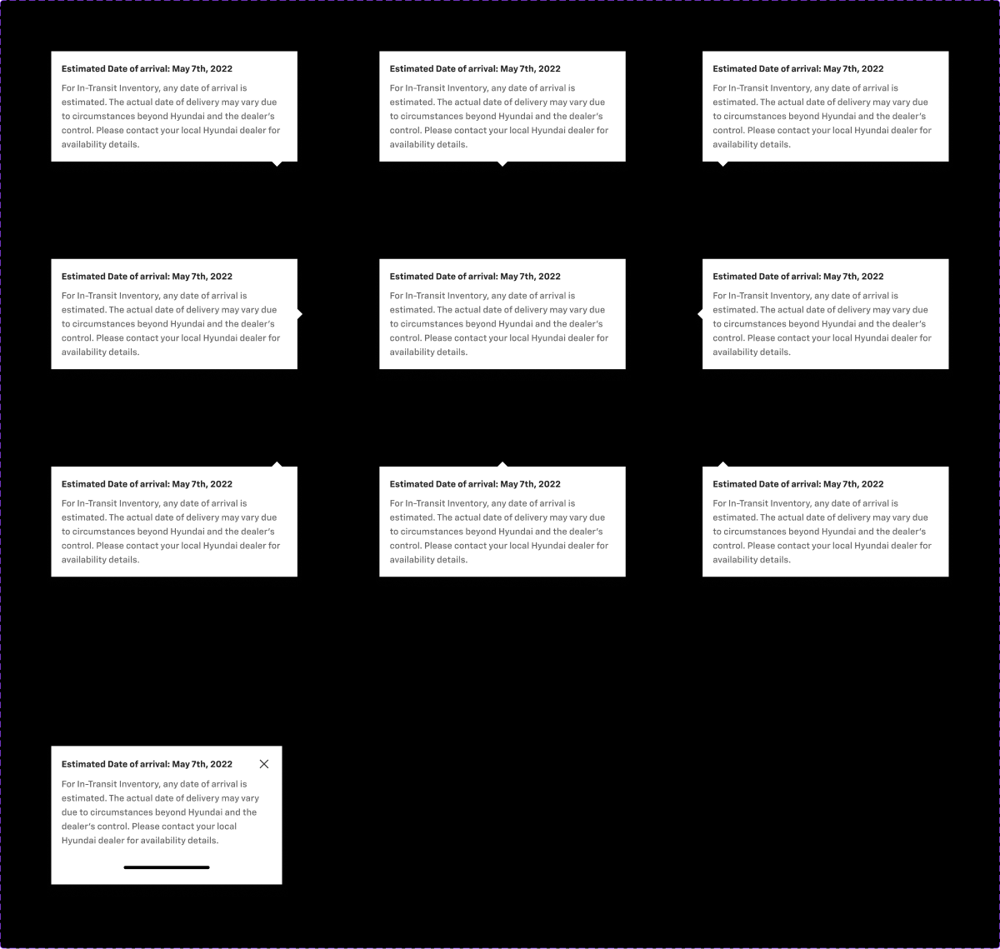

# Tooltip

## Figma
Page **Tooltip** (`3769:50192`), file `ilpJ5K66cGR85o287K4HDD`.

| Component set | Node id | Variants |
|---|---|---|
| Tooltip - Dark | `449:13058` | 10 |
| Tooltip - Light | `5042:49079` | 10 |




## Description
Figma description (both sets): "Position and Align will work when Pointer is Toggle ON". Purpose: a floating explanatory bubble, optionally with a pointer arrow, anchored to a trigger.

## Variant axes and props
- **Dark**: `mobile: off|on; Arrow: ↖ Top Left|↑ Top Center|↗ Top Right|← Middle Left|→ Middle Right|↙ Bottom Left|↓ Bottom Center|↘ Bottom Right|none`
- **Light**: `mobile: off|on; pointer:` the same 9 values. The axis is named `pointer` in Light but `Arrow` in Dark.
- `mobile=on` exists only with no arrow/pointer.
- Non-variant props: `title`, `chip`, `link`, `icon` (booleans). Defaults: Dark title=false; Light title=true. All others are false.

## Anatomy (Dark, mobile=off, Arrow=↑ Top Center)
```
Tooltip (COMPONENT, V auto-layout, 384 wide, gap 0 (spacing/container/stack/none), drop shadow)
├─ Arrow      FRAME 384x8, padding-x 24 → triangle VECTOR 16x8 (same fill as the body)
└─ Container  FRAME V auto-layout, padding 16 (spacing/container/padding/s), gap 8 (spacing/container/gap/s), radius 0
   ├─ Chip - Information   (hidden; `chip` prop)
   ├─ Title Container      H, gap 8 → icon-16 (hidden) + Edit Title TEXT 14 Bold
   ├─ Edit Description     TEXT 14 Medium, fixed width 352
   └─ Link Container       (hidden; `link` prop)
```
- Width: 384 desktop (392 for left/right pointers, which add 8px of arrow), 360 for mobile.
- Body padding is 16 on all sides.

## Token table
| part | Dark | Light |
|---|---|---|
| background (body + arrow) | `bg/inverse` (#262626) | `bg/default` (#ffffff) |
| title | (hidden by default) | `text/default` 14 Bold |
| description | `text/inverse` 14 Medium | `text/subtle` 14 Medium |
| border | none | none |
| radius | 0 | 0 |
| padding / gap | 16 (`--aec-spacing-container-padding-s`) / 8 (`--aec-spacing-container-gap-s`) | same |
| shadow | 0 4 4 rgba(0,0,0,.10) + 0 10 8 rgba(0,0,0,.04), raw effect, no effect style bound (map to a `--aec-box-shadow-*` token once values are known) | same |

## Notes
- Square corners (radius 0) and no border. On a white page, the light tooltip is separated only by its shadow.
- The variant axis name differs between sets (`Arrow` vs `pointer`) and the order of values differs. Normalise to a single `placement` prop in code.
- Colours are raw hex. Spacing is bound to `spacing/container/*` variables.
- No text styles are bound. Text is Chevy Sans 14 Bold/Medium.
